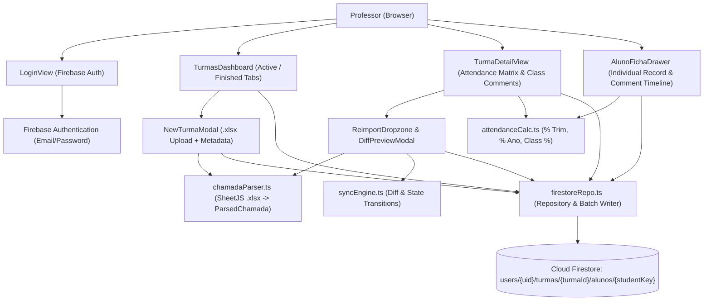

# Juntos Design

**Spec**: `.specs/features/juntos/spec.md`
**Status**: Approved

---

## Approach Exploration (Large/Complex Scope)

Before detailing the components, three viable architectures for structuring the Firebase Firestore data model and client synchronization were evaluated:

| Approach | Description | Pros | Cons | Verdict |
| -------- | ----------- | ---- | ---- | ------- |
| **1. Subcollection per Class (`turmas/{id}` + `alunos/{studentKey}`)** | Class document stores metadata, lesson columns (`lessons[]`), and class comments; each student in that class is a document in `turmas/{id}/alunos/{studentKey}` storing their attendance map and personal comments. | Dashboard loads fast (reads only `turmas` docs); adding a comment to a student writes 1 small doc; atomic `.xlsx` sync via `writeBatch`; zero risk of hitting Firestore's 1 MB doc limit. | Opening a class runs 2 parallel reads (`turma` doc + `alunos` collection). | **Recommended (Selected)** |
| **2. Single Monolithic Document per Class** | Everything (class metadata, lessons, all students, all attendance cells, all student comments) lives inside one `turmas/{id}` document. | Single document read when opening a class. | Dashboard query downloads all students and comments unnecessarily; concurrent or frequent comment edits rewrite the entire class payload. | Rejected |
| **3. Fully Normalized Top-Level Collections** | Separate top-level collections for `turmas`, `lessons`, `alunos`, `attendances`, and `comments`. | Relational normalization. | Importing a single 30-student × 31-lesson `.xlsx` triggers ~1,000 document writes/reads, quickly exhausting Firebase Spark free quotas. | Rejected |

---

## Architecture Overview

**Juntos** is a client-side Single Page Application (SPA) built with **React 19 + Vite + TypeScript**, styled with custom editorial CSS (matching `estante.willy.dev.br`'s light/dark palette), and backed by **Firebase Authentication** and **Cloud Firestore**.

A pure, deterministic **Domain Layer** (`src/domain/`) handles `.xlsx` parsing (`chamadaParser.ts`), attendance percentage calculation (`attendanceCalc.ts`), and re-import diffing/synchronization (`syncEngine.ts`). This separation guarantees that all complex business rules (parsing `Turma Pampulha QUA.xlsx`, calculating `% Trim` / `% Ano`, detecting `Inscrição Baixada` without duplicate comments, and handling re-enrollments) are 100% unit-testable without network mocks.



---

## Code Reuse Analysis

### Existing Components & Conventions to Leverage

| Pattern / Reference | Source | How to Use |
| ------------------- | ------ | ---------- |
| Editorial Light/Dark CSS Tokens & Layout | `https://estante.willy.dev.br/` | Reuse typography (`Georgia` serif hero, `system-ui` body), warm surface palette (`#f6f5f1` / `#1b1b1b`), forest green primary (`#2c5f4a`), amber accent (`#f59e0b`), `.tabs`, `.tag`, `.warning`, and `.login` card patterns in `src/index.css`. |
| Reference `.xlsx` Fixture | `Turma Pampulha QUA.xlsx` | Use directly in automated Vitest integration tests to verify real-world `.xlsx` parsing and attendance formulas. |

### Integration Points

| System | Integration Method |
| ------ | ------------------ |
| Firebase Authentication | `firebase/auth` (`onAuthStateChanged`, `signInWithEmailAndPassword`, `signOut`) initialized via `VITE_FIREBASE_*` env vars (with graceful fallback/demo mode for local testing). |
| Cloud Firestore | `firebase/firestore` (`collection`, `doc`, `getDocs`, `setDoc`, `updateDoc`, `writeBatch`, `query`, `orderBy`) scoped under `users/{uid}/turmas`. |
| SheetJS (`xlsx`) | Browser `ArrayBuffer` parsing (`XLSX.read(buffer, { type: 'array' })`) inside `src/domain/chamadaParser.ts`. |

---

## Components

### 1. `chamadaParser` (Domain)
- **Purpose**: Parse a raw `.xlsx` `ArrayBuffer` in the `chamada` format into a strongly typed `ParsedChamada` structure or throw a descriptive `ChamadaParseError`.
- **Location**: `src/domain/chamadaParser.ts`
- **Interfaces**:
  - `parseChamadaBuffer(buffer: ArrayBuffer): ParsedChamada` — validates workbook, locates sheet `chamada` (or first sheet), extracts `A1` (city/branch), `A2` (spreadsheet class name), row 2 (`G2+` course), row 3 (`G3+` theme), row 4 (`G4+` instructor), row 6 (`ID`, `Nome`, `Status`, `G6+` dates), and rows `7+` (students and attendance marks `P`, `A`, `R`, `F`, `J`).
  - `normalizeStudentKey(id: string, name: string): string` — returns canonical student key (`id.trim()` if non-empty, else normalized lowercase slug of `name`).
  - `parseLessonDateKey(rawDate: string): { dateKey: string; isoDate: string; displayDate: string }` — normalizes `DD/MM/YY` or `DD/MM/YYYY` strings into sortable ISO dates (`YYYY-MM-DD`) and display labels (`DD/MM/YY`).
- **Dependencies**: `xlsx`
- **Reuses**: None (pure domain module).

### 2. `attendanceCalc` (Domain)
- **Purpose**: Compute student `% Trim`, `% Ano`, and per-lesson class `% Presença` identically to the Excel formulas in `Turma Pampulha QUA.xlsx`.
- **Location**: `src/domain/attendanceCalc.ts`
- **Interfaces**:
  - `calculateAttendancePercentage(codes: Array<AttendanceCode | undefined | null>): number | null` — returns `Math.round(100 * count(P,A,R) / count(P,A,R,F,J))` or `null` when total counted codes is `0`.
  - `computeStudentMetrics(lessons: LessonColumn[], presencas: Record<string, AttendanceCode>): StudentMetrics` — sorts lessons newest-first, takes up to the 9 most recent lessons for `percentTrim` and all lessons for `percentAno`, plus counts of `P`, `A`, `R`, `F`, `J`.
  - `computeLessonPresenceRate(dateKey: string, students: AlunoRecord[]): number | null` — computes class attendance rate for a single lesson date.
- **Dependencies**: `src/domain/types.ts`
- **Reuses**: None (pure domain module).

### 3. `syncEngine` (Domain)
- **Purpose**: Compute a non-destructive diff and updated state when re-importing a `ParsedChamada` into an existing `Turma` and its `AlunoRecord[]`.
- **Location**: `src/domain/syncEngine.ts`
- **Interfaces**:
  - `computeReimportPlan(existingTurma: Turma, existingStudents: AlunoRecord[], parsed: ParsedChamada, importDateIso: string): ReimportPlan` — returns:
    - `diffSummary`: counts and lists of added/updated lesson dates, newly enrolled students, dropped students (`Ativo` → `Inscrição Baixada`), and re-enrolled students (`Inscrição Baixada` → `Ativo`).
    - `updatedLessons`: merged chronological list of `LessonColumn` items.
    - `updatedStudents`: updated `AlunoRecord[]` where missing previously `Ativo` students transition to `Inscrição Baixada` with a single automatic system comment (`"Inscrição baixada: aluno não consta na planilha importada em DD/MM/AAAA."`), already-dropped students do not get duplicate drop comments, and reappearing dropped students transition back to `Ativo` with a system re-enrollment comment.
- **Dependencies**: `src/domain/types.ts`, `src/domain/chamadaParser.ts`, `src/domain/attendanceCalc.ts`
- **Reuses**: `normalizeStudentKey` from `chamadaParser.ts`.

### 4. `firestoreRepo` (Data / Service Layer)
- **Purpose**: Persist and query `Turma` documents and `AlunoRecord` subcollections in Firestore using atomic chunked batches (`≤ 450` writes per batch).
- **Location**: `src/services/firestoreRepo.ts`
- **Interfaces**:
  - `listTurmas(uid: string): Promise<Turma[]>`
  - `getTurmaWithAlunos(uid: string, turmaId: string): Promise<{ turma: Turma; alunos: AlunoRecord[] }>`
  - `createTurmaFromImport(uid: string, input: CreateTurmaInput, parsed: ParsedChamada, nowIso?: string): Promise<Turma>`
  - `applyReimportPlan(uid: string, turmaId: string, plan: ReimportPlan, nowIso?: string): Promise<void>`
  - `updateTurmaMetadata(uid: string, turmaId: string, patch: UpdateTurmaMetadataInput): Promise<void>`
  - `setTurmaStatus(uid: string, turmaId: string, status: 'Ativa' | 'Encerrada', closingComment?: string, nowIso?: string): Promise<void>`
  - `addTurmaComment(uid: string, turmaId: string, text: string, nowIso?: string): Promise<CommentEntry>`
  - `addAlunoComment(uid: string, turmaId: string, studentKey: string, text: string, nowIso?: string): Promise<CommentEntry>`
- **Dependencies**: `firebase/firestore`, `src/domain/*`
- **Reuses**: Pure domain models and `syncEngine` outputs.

### 5. UI Components (`src/components/`)
- **`LoginView.tsx`**: Email/password authentication screen matching the `estante.willy.dev.br` login card, with localized Portuguese error messages.
- **`HeroHeader.tsx`**: Editorial banner (`Juntos.`) with professor email display and sign-out action.
- **`TurmasDashboard.tsx`**: Tabs for `Turmas Ativas`, `Turmas Encerradas`, and `+ Nova Turma`; displays class cards with `cátedras` badges, day/time, location, active/dropped student counts, and quick action to open a class.
- **`NewTurmaModal.tsx`**: Drag-and-drop `.xlsx` upload that parses the file immediately, pre-fills class name (`A2`) and location (`A1`), prompts for day/time and comma-separated `cátedras`, previews parsed students/lessons, and creates the class.
- **`TurmaDetailView.tsx`**: Full class workspace with metadata editor, status controls (`Encerrar turma` modal with closing comment / `Reabrir turma`), class comments panel, student filter bar (`Todos`, `Ativos`, `Inscrição Baixada` + search by name/ID), `.xlsx` re-import trigger, and the interactive Attendance Matrix table (with hover details for lesson `Tema` and `Instrutor`).
- **`ReimportModal.tsx`**: Upload updated `.xlsx` for an active class, inspect the `DiffSummary` (added dates, new students, students dropping to `Inscrição Baixada`), and confirm atomic sync.
- **`AlunoFichaDrawer.tsx`**: Individual student slide-over drawer showing student `ID`, `Nome`, `Status` badge (`Ativo` vs `Inscrição Baixada`), `% Trim`, `% Ano`, breakdown of `P`/`A`/`R`/`F`/`J`, per-lesson attendance table with theme/instructor, and the chronological comment timeline (system drop/re-enrollment notices + professor comment form).

---

## Data Models

```typescript
export type AttendanceCode = 'P' | 'A' | 'R' | 'F' | 'J';

export type TurmaStatus = 'Ativa' | 'Encerrada';

export type EnrollmentStatus = 'Ativo' | 'Inscrição Baixada';

export interface LessonColumn {
  dateKey: string;       // Original DD/MM/YY from Row 6 (e.g. "14/10/26")
  isoDate: string;       // Normalized YYYY-MM-DD (e.g. "2026-10-14")
  course: string;        // From Row 2 (e.g. "Filosofia para viver")
  theme: string;         // From Row 3 (e.g. "Transpasso Aula 10")
  instructor: string;    // From Row 4 (e.g. "Willy Garabini Cornelissen")
}

export interface CommentEntry {
  id: string;
  authorType: 'professor' | 'sistema';
  text: string;
  createdAt: string;     // ISO-8601 timestamp
}

export interface Turma {
  id: string;
  nome: string;
  diaHorario: string;
  local: string;
  catedras: string[];
  cidadePlanilha?: string;
  status: TurmaStatus;
  lessons: LessonColumn[];
  comentarios: CommentEntry[];
  activeStudentsCount: number;
  droppedStudentsCount: number;
  createdAt: string;
  updatedAt: string;
  closedAt?: string;
}

export interface AlunoRecord {
  studentKey: string;    // Canonical key (ID from Col A, or slugified Nome)
  externalId: string;    // Col A value (e.g. "14820")
  sequencia?: number;    // Col B value
  nome: string;          // Col C value
  status: EnrollmentStatus;
  presencas: Record<string, AttendanceCode>; // Keyed by LessonColumn.dateKey
  comentarios: CommentEntry[];
  enrolledAt: string;
  droppedAt?: string;
  updatedAt: string;
}

export interface StudentMetrics {
  percentTrim: number | null; // 0-100 across up to 9 most recent lessons, or null ("-")
  percentAno: number | null;  // 0-100 across all lessons, or null ("-")
  counts: Record<AttendanceCode, number>;
  totalCounted: number;
}
```

**Relationships**:
- Each authenticated professor (`uid`) owns `users/{uid}/turmas/{turmaId}`.
- Each `Turma` owns `users/{uid}/turmas/{turmaId}/alunos/{studentKey}`.

---

## Error Handling Strategy

| Error Scenario | Handling | User Impact |
| -------------- | -------- | ----------- |
| Invalid file format or missing `Row 6` headers (`ID`, `Nome`) | `parseChamadaBuffer` throws `ChamadaParseError` with specific missing field details before any Firestore write. | Displays red `.warning` alert inside the upload modal explaining what is missing in the spreadsheet. |
| Empty spreadsheet (0 student rows below `Row 6`) | `parseChamadaBuffer` throws `ChamadaParseError` refusing empty student list. | Prevents accidental mass drop of existing students; displays actionable validation message. |
| Excel cells contain only formulas (`% Trim`, `% Ano`) without cached values | `attendanceCalc` ignores cached formula strings and recomputes percentages from raw `P`/`A`/`R`/`F`/`J` marks. | Users always see accurate percentages regardless of how Excel saved formula caches. |
| Firebase Auth failure (wrong password, user not found, network error) | Map Firebase error codes (`auth/invalid-credential`, `auth/too-many-requests`, etc.) in `LoginView`. | Shows clear Portuguese message (`"E-mail ou senha inválidos."`, etc.) and re-enables button. |
| Firestore write failure during class creation or re-import | Wrap chunked `writeBatch` in `try/catch`; keep modal state open on rejection. | No partial student/attendance state is committed; professor sees error banner and can retry. |

---

## Risks & Concerns

| Concern | Location (file:line) | Impact | Mitigation |
| ------- | -------------------- | ------ | ---------- |
| Two-digit years in `Turma Pampulha QUA.xlsx` (`14/10/26`) and reverse column order (`G` = newest, `AK` = oldest) | `Turma Pampulha QUA.xlsx` (Row 6 `G6:AK6`) | Naive string sorting or `new Date("14/10/26")` in JS breaks chronological ordering and `% Trim` (which must use the 9 most recent dates). | Implement explicit `DD/MM/YY` parser (`2000 + yy`) in `src/domain/chamadaParser.ts` and sort lessons by `isoDate` descending when computing `% Trim`. |
| Firestore `writeBatch` limit of 500 operations | `src/services/firestoreRepo.ts` | Large classes (>450 students) would fail a single batch commit. | Chunk all batch writes in `firestoreRepo.ts` into batches of at most 450 operations. |
| Local development / automated testing without live Firebase credentials | `src/services/firebase.ts` | App or tests could crash if `VITE_FIREBASE_API_KEY` is not yet configured in `.env`. | Provide an automatic LocalStorage-backed repository adapter (`localRepo.ts`) using the exact same `TurmaRepository` interface when Firebase env vars are absent or in demo/test mode, while supporting live Firebase Auth + Firestore whenever `VITE_FIREBASE_*` is configured. |

---

## Tech Decisions (only non-obvious ones)

| Decision | Choice | Rationale |
| -------- | ------ | --------- |
| Repository abstraction (`TurmaRepository` interface with Firestore + LocalStorage fallback) | Implement `firestoreRepo.ts` (live Firebase) and `localRepo.ts` (persistent browser fallback when `VITE_FIREBASE_API_KEY` is not set or in demo mode) behind one interface | Lets the professor test and use the full UI immediately out of the box locally or in preview, and seamlessly switches to Firebase Auth + Cloud Firestore when Firebase config is provided. |
| Date key representation in `presencas` map | Key attendance records by normalized `DD/MM/YY` (`dateKey`) alongside `isoDate` (`YYYY-MM-DD`) on `LessonColumn` | Matches the spreadsheet headers directly while allowing accurate chronological sorting and `% Trim` slicing. |
| GitHub Pages base path configuration | Use relative base (`base: './'`) in `vite.config.ts` | Ensures assets load properly whether deployed to a custom domain (`juntos.willy.dev.br`) or a project subpath (`username.github.io/juntos/`). |
